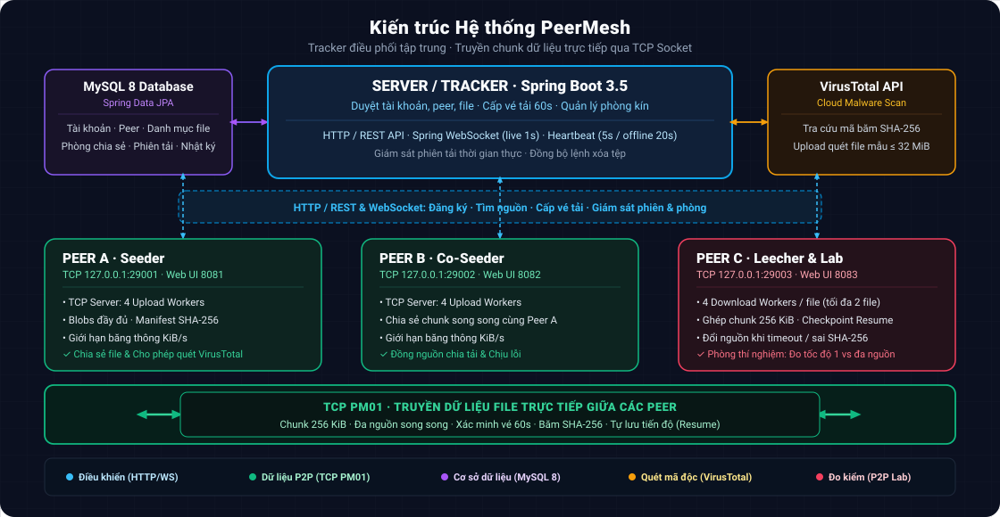
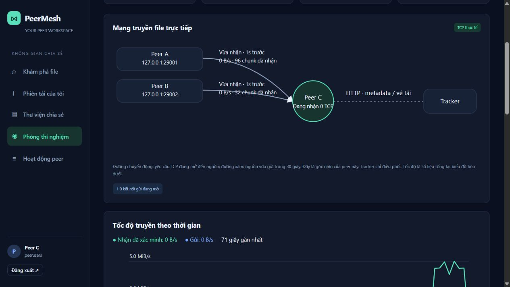
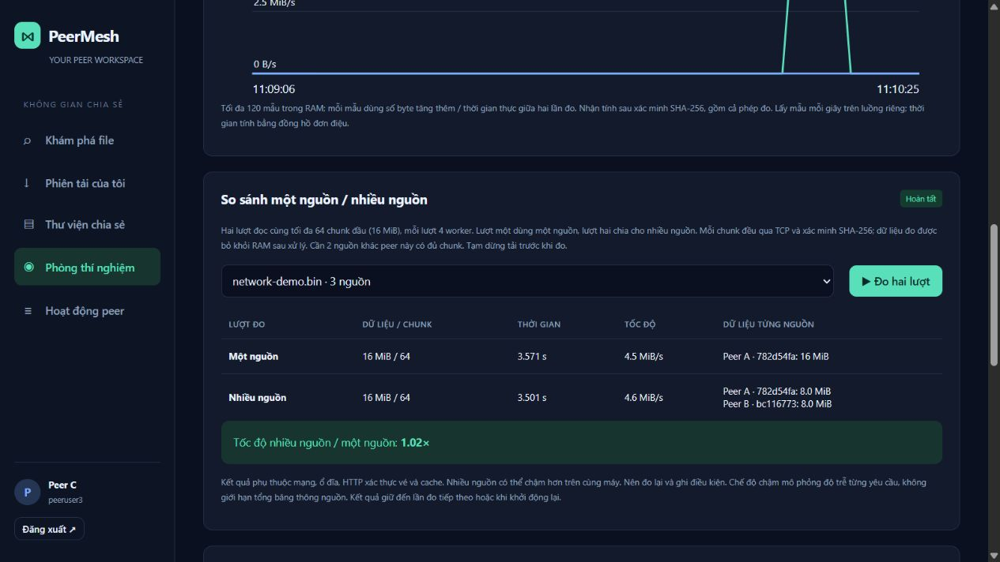

# BÀI TẬP LỚN: LẬP TRÌNH MẠNG

## PeerMesh - Hệ thống chia sẻ file ngang hàng P2P

---

## 🧑‍💻 THÔNG TIN NHÓM

| STT | Họ và Tên | MSSV | Email | Đóng góp |
|:---:|-----------|:----:|-------|----------|
| 1 | **Vũ Quốc Hiệp** | B23DCCN295 | HiepVQ.B23CN295@stu.ptit.edu.vn | - Xây dựng giao diện và tính năng quản lý thiết bị, tài khoản, danh mục file<br>- Xây dựng tính năng tìm kiếm, tải file đa nguồn, theo dõi tiến độ và quản lý file<br>- Tích hợp dịch vụ quét mã độc VirusTotal |
| 2 | **Phạm Minh** | B23DCCN561 | MinhP.B23CN561@stu.ptit.edu.vn | - Xây dựng tính năng theo dõi phiên tải, nhật ký hệ thống (audit log), dashboard<br>- Xây dựng tính năng phòng thí nghiệm P2P (Lab) và cài đặt thông số băng thông<br>- Xây dựng tính năng phòng chia sẻ riêng tư (Shared Rooms) |

**Tên nhóm:** Nhóm 12 – Lập trình mạng  
**Chủ đề đã đăng ký:** Xây dựng hệ thống chia sẻ file ngang hàng P2P PeerMesh

---

## 🧠 MÔ TẢ HỆ THỐNG

**PeerMesh** là hệ thống chia sẻ tệp tin lai (Hybrid P2P) kết hợp giữa máy chủ điều phối trung tâm và mạng lưới các nút mạng truyền dữ liệu trực tiếp:

1. **Server / Tracker:** Đóng vai trò làm registry trung tâm, quản lý tài khoản, phê duyệt thiết bị peer và danh mục file, cấp vé tải bảo mật (Ticket) và giám sát trạng thái trực tuyến của toàn mạng. Server chỉ lưu trữ metadata và không can thiệp vào luồng tải nội dung file.
2. **Client / Peer:** Mỗi peer là một ứng dụng độc lập vừa có thể làm nguồn phát (Seeder) vừa có thể tải về (Leecher). Dữ liệu được chia nhỏ thành các chunk 256 KiB và truyền song song trực tiếp qua kết nối Socket TCP giữa các peer, đối soát tính toàn vẹn bằng thuật toán băm SHA-256.
3. **Phòng chia sẻ (Rooms) & Phòng thí nghiệm (Lab):** Hỗ trợ tạo nhóm chia sẻ kín có mật khẩu và cung cấp module đo đạc trực quan hiệu năng tải một nguồn so với đa nguồn.

**Cấu trúc logic tổng quát:**

```text
Peer A (Client)  <==== Socket TCP (Truyền Chunk trực tiếp) ====>  Peer B / Peer C...
       │                                                                      │
       └─────────────── HTTP REST / Spring WebSocket RFC 6455 ────────────────┘
                                      │
                                      ▼
                         Tracker Server (Spring Boot)
                                      │
                   ┌──────────────────┴──────────────────┐
                   ▼                                     ▼
           Database (MySQL 8)                   VirusTotal Cloud API
```

**Sơ đồ hệ thống:**



---

## ⚙️ CÔNG NGHỆ SỬ DỤNG

| Thành phần | Công nghệ | Ghi chú |
|------------|-----------|---------|
| **Server (Tracker)** | Java 17 + Spring Boot 3.5 | Xử lý nghiệp vụ, REST API, WebSocket realtime |
| **Client (Peer)** | Java Socket TCP + Spring Boot | Đa luồng upload/download, thuật toán chia tải chunk |
| **Giao thức P2P** | TCP nhị phân | Tải song song đa nguồn, chunk 256 KiB |
| **Cơ sở dữ liệu** | MySQL 8 + Spring Data JPA | Quản lý tài khoản, thiết bị, metadata file, phòng kín |
| **Bảo mật & Toàn vẹn** | SHA-256, BCrypt, VirusTotal API | Kiểm tra băm toàn file/chunk, quét mã độc cloud |
| **Giao diện Web** | React, Vite, SCSS | Tương thích với ứng dụng Java |
| **Build & Test** | Maven, JUnit 5 | Tự động hóa build, kiểm thử đơn vị và kịch bản E2E |

---

## 🚀 HƯỚNG DẪN CHẠY DỰ ÁN

### 1. Chuẩn bị môi trường & Cơ sở dữ liệu

* Yêu cầu máy đã cài **JDK 17+**, **Maven 3.8+**, **Node.js 20.19+ hoặc 22.12+** kèm npm, và **MySQL 8**.
* Khởi động dịch vụ MySQL và tạo sẵn cơ sở dữ liệu `peermesh`:

```sql
CREATE DATABASE IF NOT EXISTS peermesh CHARACTER SET utf8mb4 COLLATE utf8mb4_unicode_ci;
```

> *Mặc định hệ thống kết nối MySQL tại `localhost:3306` với user `root` (không mật khẩu). Đổi tài khoản mật khẩu qua biến môi trường `DB_USERNAME`, `DB_PASSWORD` nếu cần.*

### 2. Biên dịch dự án

Mở terminal tại thư mục gốc của dự án và chạy:

```powershell
mvn -f source/pom.xml package -DskipTests
```

Maven cài thư viện từ lockfile và build cả hai giao diện. JAR đã build có thể chạy bằng Java mà không cần Node.js.

Để sửa frontend với Vite, chạy các lệnh sau từ thư mục gốc. Giữ tracker và peer chạy ở cổng tương ứng để Vite chuyển tiếp API và WebSocket.

```powershell
npm --prefix source/frontend ci
npm --prefix source/frontend run dev:admin
# Mở terminal khác để chạy giao diện peer
npm --prefix source/frontend run dev:peer
```

Giao diện phát triển dùng cổng 5173 (tracker) và 5174 (peer). Nếu backend chạy cổng khác, đặt biến môi trường `VITE_TRACKER_URL` hoặc `VITE_PEER_URL` trước khi chạy Vite.

### 3. Khởi động Server (Tracker)

Mở một cửa sổ PowerShell riêng để chạy tracker:

```powershell
powershell -ExecutionPolicy Bypass -File source/run.ps1 -Role server
```
* **Giao diện quản trị Tracker:** Mở trình duyệt tại [http://127.0.0.1:8080](http://127.0.0.1:8080)
* Tài khoản quản trị mặc định: `admin` (khởi tạo mật khẩu trong lần chạy đầu tiên).

### 4. Khởi động các Client (Peer)

Mở các cửa sổ PowerShell tiếp theo để giả lập nhiều máy trạm ngang hàng trong mạng:

```powershell
# Chạy Peer A (Cổng Web 8081, Cổng TCP 9001)
powershell -ExecutionPolicy Bypass -File source/run.ps1 -Role peer -WebPort 8081 -TcpPort 9001

# Chạy Peer B (Cổng Web 8082, Cổng TCP 9002)
powershell -ExecutionPolicy Bypass -File source/run.ps1 -Role peer -WebPort 8082 -TcpPort 9002

# Chạy Peer C (Cổng Web 8083, Cổng TCP 9003)
powershell -ExecutionPolicy Bypass -File source/run.ps1 -Role peer -WebPort 8083 -TcpPort 9003
```

### 5. Trải nghiệm nhanh

1. Truy cập giao diện người dùng:
   * **Peer A:** [http://127.0.0.1:8081](http://127.0.0.1:8081)
   * **Peer B:** [http://127.0.0.1:8082](http://127.0.0.1:8082)
   * **Peer C:** [http://127.0.0.1:8083](http://127.0.0.1:8083)
2. Đăng ký tài khoản trên Peer và vào trang quản trị Tracker (`:8080`) duyệt tài khoản & thiết bị.
3. Chia sẻ file từ Peer A/B, duyệt file trên Tracker và dùng Peer C để tải về hoặc vào **Phòng thí nghiệm** để so sánh tốc độ.

---

## 🔗 GIAO TIẾP (GIAO THỨC SỬ DỤNG)

| Endpoint / Cổng | Giao thức | Phương thức | Input | Output |
|-----------------|:---------:|:-----------:|-------------------------|-------------------------|
| `/api/auth/register` | HTTP/1.1 | POST | `{"username", "password"}` | `{"status": "PENDING"}` |
| `/api/auth/login` | HTTP/1.1 | POST | `{"username", "password"}` | Thông tin phiên, vai trò và cookie |
| `/api/peers/heartbeat` | HTTP/1.1 | POST | `{"peerId", "tcpPort"}` | Xác nhận duy trì trạng thái online |
| `/api/catalog` | HTTP/1.1 | GET | `?q=filename` | Danh sách tệp đã duyệt và danh sách nguồn |
| `/api/transfers/ticket` | HTTP/1.1 | POST | `{"fileId", "targetPeerId"}` | Vé tải ký số thời hạn 60s |
| `/api/rooms` | HTTP/1.1 | POST | `{"name", "password"}` | Tạo nhóm chia sẻ riêng tư kèm mã phòng |
| `/ws/realtime` | WebSocket | CONNECT | Session Cookie | Snapshot dữ liệu toàn mạng đẩy mỗi giây |
| `TCP Port (9001..)` | TCP | Socket | Handshake + Ticket + Chunk Index | Luồng nhị phân chunk 256 KiB + SHA-256 |

---

## 📊 KẾT QUẢ THỰC NGHIỆM

Hệ thống được kiểm thử thực tế với kịch bản truyền tải tệp từ nhiều nguồn đồng thời và giả lập sự cố mạng:

### 1. Giao diện đo đạc hiệu năng (P2P Lab)
Hiển thị sơ đồ kết nối trực quan giữa các peer, đồ thị lưu lượng thời gian thực và lịch sử truyền tải từng chunk.



### 2. So sánh tốc độ tải: Một nguồn vs Đa nguồn
Kiểm thử tải cùng một tệp tin lớn cho thấy cơ chế chia tải đa nguồn đạt tốc độ vượt trội so với tải từ một nguồn đơn lẻ.



* **Khả năng chịu lỗi:** Khi tắt đột ngột một seeder hoặc giả lập chunk lỗi, máy nhận tự động phát hiện sai mã băm SHA-256 và chuyển kết nối sang nguồn dự phòng mà không phải tải lại từ đầu.
* **Tạm dừng và khôi phục:** Trạng thái tải được lưu bền vững qua Checkpoint JSON, tự động tiếp tục khi khởi động lại peer.

---

## 🧩 CẤU TRÚC DỰ ÁN

```text
P2P_File/
├── README.md                      # Báo cáo tổng quan dự án
├── INSTRUCTION.md                 # Yêu cầu đề bài môn học
├── statics/                       # Sơ đồ kiến trúc và ảnh thực nghiệm
│   ├── peermesh-diagram.svg
│   ├── lab-preview.png
│   └── lab-comparison.png
└── source/
    ├── pom.xml                    # Maven parent quản lý multi-module
    ├── build.ps1, run.ps1         # Script tự động hóa build và chạy hệ thống
    ├── common/                    # Thư viện dùng chung (Manifest, Protocol PM01, Assets)
    ├── server/                    # Ứng dụng Tracker (Spring Boot, JPA, MySQL, WebSocket)
    │   └── src/main/resources/schema-mysql.sql
    └── client/                    # Ứng dụng Peer Client (TCP Engine, Storage, Web UI)
```

---

## 🧩 HƯỚNG PHÁT TRIỂN THÊM

- [ ] Hỗ trợ kỹ thuật NAT Traversal (STUN/TURN/UPnP) để kết nối peer qua nhiều lớp mạng ngoài Internet
- [ ] Bổ sung mã hóa đầu-cuối (End-to-End Encryption) bảo vệ an toàn nội dung tệp tin
- [ ] Điều chỉnh linh hoạt kích thước chunk theo chất lượng đường truyền (Adaptive chunk sizing)
- [ ] Xây dựng ứng dụng Desktop Client độc lập bằng JavaFX hoặc Electron

---

## 📝 GHI CHÚ

- Dự án tuân thủ cấu trúc thư mục và quy chuẩn đặt mã nguồn theo hướng dẫn môn học.
- Dữ liệu tài khoản, thiết bị và file được đồng bộ tự động trong MySQL. Mỗi client chạy trên cổng web riêng sẽ lưu profile và thư viện tách biệt.
- Hệ thống đã vượt qua các kiểm thử chi tiết.

---

## 📚 TÀI LIỆU THAM KHẢO

1. **BitTorrent Protocol Specification (BEP 0003):** Cơ chế chia file thành chunk và tải từ nhiều peer.
2. **Spring Boot & Spring Data JPA Reference Documentation:** Xây dựng dịch vụ backend và kết nối MySQL.
3. **RFC 6455 - The WebSocket Protocol:** Chuẩn giao tiếp hai chiều thời gian thực giữa client và server.
4. **VirusTotal v3 REST API Reference:** Tích hợp kiểm duyệt an toàn tập tin dựa trên điện toán đám mây.
