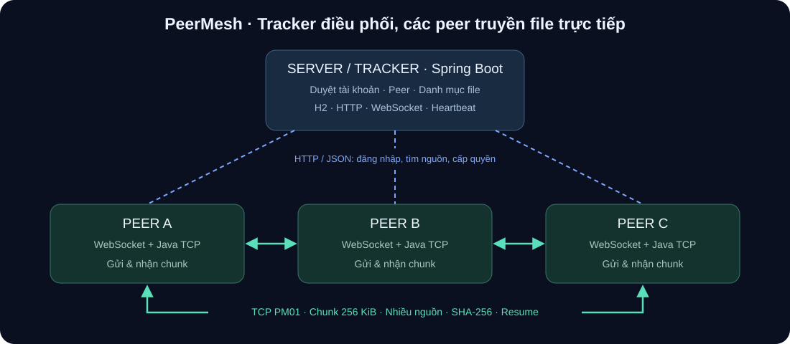
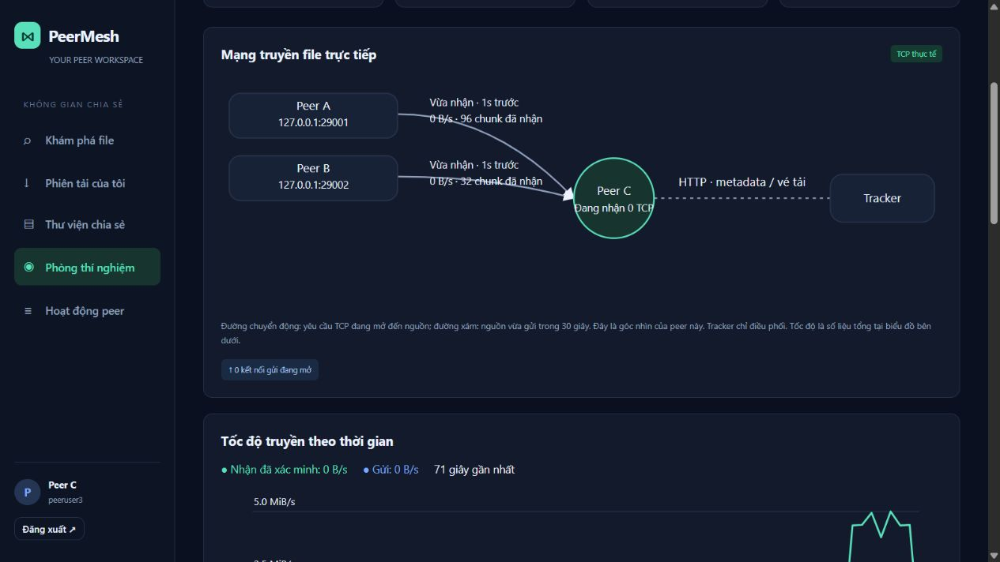
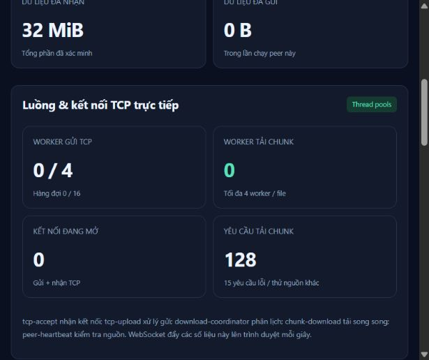

# PeerMesh — Chia sẻ file P2P có quản trị

Bài tập lớn Lập trình mạng. Java 17 + Spring Boot, giao diện web tiếng Việt, truyền file trực tiếp giữa các peer qua TCP socket.

## Thông tin nhóm

**Chủ đề:** Chia sẻ file ngang hàng P2P có tracker và cơ chế phê duyệt.

Tên nhóm, thành viên, MSSV, email, đóng góp và hạn nộp: **chưa được cung cấp — cần điền trước khi nộp**. Lịch sử Git cần thể hiện đóng góp thực tế.

## Mô tả hệ thống



- **Server / tracker:** xác thực, duyệt tài khoản / thiết bị / file, tìm nguồn, cấp vé tải, nhận báo cáo và lưu nhật ký trong H2.
- **Client / peer:** ứng dụng Java vừa tải vừa gửi các phần file qua TCP. Spring Boot cung cấp giao diện web cục bộ để người dùng điều khiển peer.
- **Common:** định dạng manifest, giao thức TCP, CSS và tiện ích web dùng chung.

Tracker lưu metadata. Nội dung file truyền trực tiếp giữa các peer. Trình duyệt đưa file vào peer cục bộ và hiển thị tiến độ; phần P2P do Java thực hiện.

## Chức năng

| Server / quản trị viên | Client / peer |
|---|---|
| Đăng nhập, phân quyền ADMIN | Đăng ký, đăng nhập, xem trạng thái duyệt |
| Duyệt / khóa / mở tài khoản | Đăng ký thiết bị bằng IP và cổng TCP |
| Duyệt / khóa / mở peer | Thêm file vào thư viện và chia sẻ |
| Duyệt / ẩn / mở file | Tìm file được duyệt, xem nguồn trực tuyến |
| Heartbeat, phát hiện peer offline | Chunk 256 KiB, tải từ nhiều peer |
| Vé tải 60 giây theo nguồn và file | Tối đa 4 kết nối / file, 2 file tải đồng thời |
| Kiểm tra lại quyền khi nguồn xác thực vé | Ưu tiên phần hiếm có nguồn; tự đổi nguồn khi lỗi |
| Dashboard và báo cáo phiên tải | Tạm dừng, tiếp tục và khôi phục sau restart |
| Nhật ký phê duyệt và đăng nhập | SHA-256 từng phần và toàn file |
| H2 lưu bền vững registry | Chia sẻ lại phần đã xác minh / file tải xong |
| BCrypt, session / bearer hết hạn sau 12 giờ | Bật / dừng chia sẻ, lưu file về máy |

Web sử dụng WebSocket để nhận snapshot trực tiếp mỗi giây. Trình duyệt tự nối lại theo exponential backoff khi mất kết nối; HTTP dự phòng mỗi 10 giây chỉ hoạt động khi WebSocket chưa kết nối. Heartbeat peer tới tracker mỗi 5 giây; sau 20 giây không có heartbeat nguồn được coi là offline. Bộ tải có timeout TCP để phát hiện lỗi kết nối.

## Công nghệ

| Thành phần | Công nghệ |
|---|---|
| Runtime | Java 17 |
| Framework | Spring Boot 3.5.16 |
| Điều phối | HTTP / JSON |
| Cập nhật thời gian thực | Spring WebSocket / RFC 6455 |
| Dữ liệu P2P | Java TCP Socket, giao thức PM01 |
| Lưu trữ server | H2 + Spring JDBC, snapshot JSON |
| Lưu trữ peer | File content-addressed, chunk và checkpoint JSON |
| Toàn vẹn / mật khẩu | SHA-256 / BCrypt |
| Giao diện | HTML, CSS, JavaScript thuần, không cần CDN / Node.js |
| Build / test | Maven, JUnit 5; Python 3 cho E2E tùy chọn |

## Cấu trúc repository

```text
jnp-project-starter/
├── README.md
├── INSTRUCTION.md                 # Giữ nguyên hướng dẫn giảng viên
├── statics/
│   ├── peermesh-diagram.svg
│   └── ...                        # Tài nguyên mẫu ban đầu
└── source/
    ├── .gitignore
    ├── pom.xml                    # Maven parent / reactor
    ├── build.ps1                  # Build Windows
    ├── run.ps1                    # Chạy server / peer Windows
    ├── common/
    │   ├── pom.xml
    │   └── src/main/, src/test/    # model, protocol, concurrent, realtime, tài nguyên web chung
    ├── server/
    │   ├── README.md
    │   ├── pom.xml
    │   └── src/main/, src/test/    # controller, service, repository, model, dto, config, websocket, exception
    └── client/
        ├── README.md
        ├── pom.xml
        └── src/main/, src/test/    # controller, service, repository, network, model, dto, config, websocket, exception
```

Toàn bộ mã nguồn ở `source/`. `target/` chứa kết quả build / test; `data/` chứa dữ liệu runtime, đều được Git bỏ qua. `common/` là module bổ sung được phép trong INSTRUCTION.md.

## Kiến thức Lập trình mạng được áp dụng

| Kiến thức | Áp dụng thực tế | Cách kiểm tra / demo |
|---|---|---|
| TCP Socket, ServerSocket | Peer nhận kết nối và truyền chunk trực tiếp | Tải file từ A và B sang C |
| Giao thức tầng ứng dụng | PM01: magic, độ dài header, JSON, status và dữ liệu nhị phân | Đọc Wire và gửi frame sai trong test |
| TCP là byte stream | readNBytes / readFully, kiểm tra độ dài và EOF | Test frame thiếu dữ liệu / payload sai hash |
| HTTP client–server | Đăng ký, xác thực, tìm nguồn, vé tải | TrackerGateway dùng Java HttpClient |
| WebSocket hai chiều | Server đẩy snapshot; trình duyệt gửi yêu cầu refresh | Nhãn WebSocket trực tiếp, không polling HTTP khi kênh ổn định |
| WebSocket handshake và bảo mật | HTTP Upgrade, session cookie, same-origin, kiểm tra quyền mỗi lần đẩy | Test anonymous / foreign Origin / logout |
| Ping / Pong | Server ping mỗi 15 giây, cắt kết nối không pong trong 45 giây | RFC 6455 test client xử lý ping / pong |
| Multithreading và thread pool | Luồng accept, 4 upload worker, 2 coordinator, 4 download worker / file | Trang Hoạt động peer hiển thị worker và kết nối thật |
| Đồng bộ đa luồng | synchronized bảo vệ state; AtomicLong / AtomicInteger cho bộ đếm; concurrent collections | 4 client cùng vào provider trong TcpTransportTest |
| Backpressure | Pool gửi 4 worker + hàng đợi tối đa 16, quá tải đóng kết nối mới | Test mở nhiều socket chưa gửi header |
| Heartbeat / failure detection | HTTP heartbeat 5 giây, TTL online 20 giây | Tắt peer, xem offline trên dashboard |
| Timeout, retry và failover | Connect 2 giây, read 8 giây, tìm nguồn lại sau 2 giây | Tắt A trong lúc C đang tải |
| Truyền file phân mảnh | Manifest, chọn phần còn thiếu, ưu tiên phần hiếm có nguồn | Lưới chunk và số byte từng nguồn |
| Toàn vẹn và phục hồi | SHA-256, checkpoint, ghi file atomic, kiểm tra lại lúc khởi động | E2E làm hỏng chunk và restart peer |
| Quản lý vòng đời kết nối | Đóng socket khi shutdown, cancel worker, reconnect WebSocket | Restart peer / tracker mà không mất dữ liệu đã lưu |

### Tổ chức package

Trong `source/server/src/main/java/vn/edu/p2p/server/`:

- `controller/`: HTTP endpoint, chuyển request tới service.
- `service/`: nghiệp vụ điều phối, xác thực và phê duyệt.
- `repository/`: lưu / đọc registry H2.
- `model/`, `dto/`: mô hình lưu trữ và request HTTP.
- `config/`: cấu hình WebSocket, header bảo vệ HTTP.
- `websocket/`: xác thực và đẩy dashboard cho quản trị viên.
- `exception/`: chuyển lỗi thành phản hồi HTTP.

Trong `source/client/src/main/java/vn/edu/p2p/client/` có các package tương tự; `network/` chứa `TcpChunkServer`, `TcpChunkClient`, `TrackerGateway`, còn `websocket/` đẩy trạng thái peer lên web.

Mỗi model và DTO nằm trong một file Java riêng, ví dụ `model/Account.java`, `model/SharedFile.java`, `dto/Login.java`, `dto/Advertisement.java` ở server; `model/Entry.java`, `model/Job.java`, `dto/Download.java` ở client.

Controller được chia theo chức năng: xác thực, peer, file/thư viện, tải file, quản trị và mô phỏng. `TrackerService` và `PeerEngine` giữ vai trò điều phối, chuyển lời gọi đến các service chuyên trách trong cùng package. `TrackerContext` và `PeerContext` giữ trạng thái dùng chung; các khóa đồng bộ, lịch heartbeat, giới hạn worker và vòng đời tài nguyên được giữ nguyên.

Trong `common/`: `model/Manifest`, `protocol/Wire` và `protocol/ChunkRequest`, `concurrent/NamedThreads`, `realtime/SnapshotSocket` và `realtime/SnapshotConnection`. Hai lớp Application ở package gốc để Spring quét các package con.

### Các luồng chính

| Tên luồng | Nhiệm vụ | Giới hạn |
|---|---|---|
| tcp-accept-* | accept socket, đưa vào hàng đợi gửi | 1 / peer |
| tcp-upload-* | Kiểm tra quyền và gửi chunk | 4 worker, queue 16 |
| download-coordinator-* | Phân lịch tải, ghép file và phục hồi | 2 phiên / peer |
| chunk-download-<job>-* | Mở socket, nhận và xác minh chunk | 4 / file, lô tối đa 16 |
| peer-heartbeat-* | Kiểm tra tracker, quảng bá phần và báo cáo | 1 / peer |
| peer-websocket-* / tracker-websocket-* | Đẩy snapshot, xử lý refresh, ping/pong | 2 / ứng dụng, tối đa 32 phiên web |
| Các luồng HTTP của Tomcat / Java HttpClient | Xử lý API và WebSocket handshake | Do framework quản lý |

Khi chạy bằng JDK có thể dùng `jcmd <PID> Thread.print` để xem tên các pool. Dữ liệu trạng thái dùng chung chỉ được đọc / sửa trong vùng synchronized tương ứng; không giữ khóa repository trong khi chờ kết nối mạng.

## Build

Cần **JDK 17+**, **Maven 3.6.3+**. Python 3 chỉ cần để chạy E2E tùy chọn. Lần build đầu cần mạng để tải dependency. Chạy ở thư mục chứa README này:

```powershell
java -version
mvn -version
mvn -f source/pom.xml package
```

Windows có thể dùng script, tự tìm Maven trong PATH hoặc Maven wrapper đã tải ở `~/.m2/wrapper/dists`:

```powershell
powershell -ExecutionPolicy Bypass -File source/build.ps1
```

ExecutionPolicy chỉ áp dụng cho tiến trình này. Có thể thêm `-Offline` nếu đã có dependency và `-Repository "duong-dan-cache"` để chọn cache Maven. Build cả reactor vì server và client phụ thuộc common.

Kết quả: `source/server/target/server-1.0.0.jar` và `source/client/target/client-1.0.0.jar`.

## Chạy demo Windows trên một máy

Mở **4 terminal**, đều ở thư mục repository.

### Terminal 1 — tracker

Lần đầu cần ADMIN_PASSWORD riêng dài 12–72 ký tự (nên dùng ASCII). Thay mật khẩu ví dụ bên dưới:

```powershell
$env:ADMIN_PASSWORD = 'ThayBangMatKhauRieng!2026'
powershell -ExecutionPolicy Bypass -File source/run.ps1 -Role server
```

Mở [quản trị](http://127.0.0.1:8080), đăng nhập `admin` và mật khẩu vừa đặt. ADMIN chỉ được bootstrap khi registry chưa có quản trị viên. Đổi biến môi trường sau đó không thay mật khẩu đã lưu.

### Terminal 2, 3, 4 — peer A, B, C

```powershell
# Terminal 2
powershell -ExecutionPolicy Bypass -File source/run.ps1 -Role peer -WebPort 8081 -TcpPort 9001 -UploadDelayMs 200

# Terminal 3
powershell -ExecutionPolicy Bypass -File source/run.ps1 -Role peer -WebPort 8082 -TcpPort 9002 -UploadDelayMs 200

# Terminal 4
powershell -ExecutionPolicy Bypass -File source/run.ps1 -Role peer -WebPort 8083 -TcpPort 9003
```

Mở [peer A](http://127.0.0.1:8081), [peer B](http://127.0.0.1:8082), [peer C](http://127.0.0.1:8083). Script tạo profile riêng theo cổng web. Mỗi profile gắn với một tài khoản. Một tài khoản có thể đăng nhập trên nhiều profile / thiết bị.

UploadDelayMs tạo độ trễ demo mỗi chunk để quan sát quá trình tải. Khi đo tốc độ thực tế, bỏ tham số hoặc đặt 0.

### Kịch bản demo

1. Đăng ký tài khoản tại peer; admin duyệt ở **Tài khoản**.
2. Đăng nhập peer, nhập tên thiết bị và IP `127.0.0.1` khi demo cùng máy.
3. Admin duyệt tại **Thiết bị peer**. Trang người dùng tự cập nhật.
4. A chọn **Chia sẻ file**, dùng file 32–100 MiB để dễ quan sát.
5. Admin duyệt tại **Danh mục file**.
6. B chia sẻ file **cùng nội dung**, tạo nguồn thứ hai với cùng SHA-256.
7. C tìm file → **Xem nguồn** → **Tải nhiều nguồn**.
8. Xem lưới chunk và lượng dữ liệu nhận từ từng nguồn.
9. Tắt A giữa chừng: C thử nguồn còn lại để hoàn tất.
10. Có thể tạm dừng C, đóng tiến trình, mở lại **cùng profile**, đăng nhập và bấm **Tiếp tục tải**.
11. Khi xong, kiểm tra SHA-256 và **Lưu file về máy**. C cũng trở thành nguồn.
12. Trên server xem trạng thái peer, phiên tải và nhật ký quản trị.

Nếu tải quá nhanh, dùng file lớn hơn hoặc tăng độ trễ demo. Giao diện dùng tiến độ thực tế.

## Phòng thí nghiệm P2P

Sau khi đăng nhập, mở **Phòng thí nghiệm** trên thanh bên của peer.



Ảnh bảng so sánh và kết quả kiểm thử: [xác minh phòng thí nghiệm](./statics/lab-validation.md).

- **Sơ đồ trực tiếp:** hiện nguồn có yêu cầu TCP đang mở đến peer này, tên / địa chỉ nguồn, số kết nối, chunk đang yêu cầu, tốc độ và tổng chunk đã nhận trong lần chạy. Nguồn vừa gửi được giữ 30 giây bằng đường xám; đường chuyển động biểu thị yêu cầu đang mở. Các kết nối gửi ra được liệt kê bằng địa chỉ TCP đích. Sơ đồ là góc nhìn cục bộ, không suy đoán toàn bộ mạng. Đường tracker thể hiện điều phối metadata / vé, không phải đường truyền nội dung file.
- **Biểu đồ tốc độ:** nhận đã xác minh và gửi, tính từ chênh lệch byte / thời gian thực, tối đa 120 mẫu trong RAM. Bộ lấy mẫu chạy trên luồng peer-metrics riêng mỗi giây, dùng đồng hồ đơn điệu để tính thời gian và không chờ heartbeat. Bao gồm lưu lượng phép đo. Tốc độ trên thẻ phiên tải vẫn là trung bình phiên đang chạy.
- **So sánh một nguồn / nhiều nguồn:** chọn file có ít nhất 2 chunk và 2 nguồn khác peer nhận có đủ tối đa 64 chunk đầu. Hai lượt đọc cùng tập chunk (tối đa 16 MiB / lượt), đều dùng 4 worker, qua TCP thật và xác minh SHA-256. Lượt đầu dùng một nguồn; lượt sau chia chunk cho các nguồn. Vé được lấy mới trước mỗi lượt. Không ghi dữ liệu phép đo vào thư viện hoặc checkpoint; có thể đo lại cả file đã tải. Hiện thời gian, tốc độ, byte từng nguồn và tỷ số tốc độ. Nếu một lượt lỗi thì ghi lỗi, không kết luận tỷ số. Chỉ chạy một phép đo tại peer này và cần dừng các phiên tải để giảm nhiễu.
- **Mô phỏng lỗi nguồn:** bật tại peer A đang gửi; quan sát tại peer C đang nhận. Có thêm độ trễ 1500 ms / yêu cầu, đóng kết nối trước payload, hoặc lật một byte trên bản gửi để gây sai SHA-256. Mọi lỗi tự hết sau 30 giây trên giao diện; **Bình thường** khôi phục ngay cho các yêu cầu tiếp theo. File gốc không thay đổi; đăng xuất / khởi động lại cũng đưa mô phỏng về bình thường. Bộ đếm hiển thị số yêu cầu chịu mô phỏng.

### Kịch bản trình bày

1. Cho A và B chia sẻ cùng file 32 MiB trở lên; duyệt tài khoản, peer và file như phần demo.
2. Tại C mở Phòng thí nghiệm, chọn file, bấm **Đo hai lượt**; xem sơ đồ khi đo và so sánh kết quả. Tải lại mạng LAN để thu số liệu cho báo cáo.
3. Tại C bắt đầu tải file trong Khám phá, trở lại Phòng thí nghiệm để xem sơ đồ và đồ thị.
4. Tại A bật **Gửi chunk sai SHA-256** hoặc **Ngắt kết nối**; tại C xem nhật ký lỗi và chuyển sang B. Bấm **Bình thường** tại A hoặc đợi hết hạn để phục hồi.
5. Khi tải xong, xem nhãn SHA-256 toàn file hợp lệ và lưu file về máy.

Nhiều nguồn không đảm bảo nhanh hơn, nhất là các peer chạy chung máy. Hai lượt chạy lần lượt (một nguồn trước), có ảnh hưởng cache, tải nền, HTTP xác thực vé, ổ đĩa và mạng. Chế độ chậm mô phỏng độ trễ từng yêu cầu, không giới hạn tổng băng thông mỗi nguồn. Báo cáo phải ghi điều kiện đo và kết quả thật.

API mới (cần session đăng nhập peer và tài khoản / peer được duyệt):

- `POST /api/lab/benchmark` với `{ "fileId": "<sha256>" }`; kết quả / trạng thái ở `GET /api/status` → `lab.benchmark`.
- `POST /api/lab/fault` với `{ "mode": "NORMAL|SLOW|DISCONNECT|CORRUPT", "delayMs": 1500, "seconds": 30 }`. API giới hạn thời hạn 1–120 giây, độ trễ 0–5000 ms. Mô phỏng áp dụng cho mọi yêu cầu chunk được nguồn xác thực trong thời hạn.
- `lab.links`, `lab.recentLinks`, `lab.sourceStats`, `lab.samples`, `lab.fault` được đưa vào snapshot WebSocket hiện có. Dữ liệu lab chỉ giữ trong RAM, không chứa vé tải.

## Chạy trên nhiều máy LAN

1. Chạy tracker trên máy có IP LAN, ví dụ `192.168.1.10`.
2. Trên các máy khác:

```powershell
powershell -ExecutionPolicy Bypass -File source/run.ps1 -Role peer -WebPort 8081 -TcpPort 9001 -TrackerUrl http://192.168.1.10:8080
```

3. Mở web peer **trên chính máy chạy peer**, nhập IPv4 LAN của máy đó khi đăng nhập. Xem IP bằng `ipconfig`.
4. Cho phép TCP 8080 vào máy tracker và cổng TCP đã chọn trên các máy peer trong firewall của mạng demo. Chương trình không tự thay đổi firewall.
5. Admin duyệt rồi thực hiện kịch bản trên.

Web peer mặc định bind 127.0.0.1, TCP chia sẻ lắng nghe trên các interface. Mỗi máy có thể dùng cùng TCP port vì IP khác nhau. Đổi IP / cổng đã đăng ký đưa thiết bị về chờ duyệt.

## Chạy trực tiếp JAR / Linux

```bash
ADMIN_PASSWORD='ThayBangMatKhauRieng!2026' java -jar source/server/target/server-1.0.0.jar

java -jar source/client/target/client-1.0.0.jar \
  --server.port=8081 --peer.tcp-port=9001 \
  --peer.data=./source/data/peer-a --peer.tracker=http://127.0.0.1:8080
```

Mỗi instance peer phải có thư mục dữ liệu riêng; khóa profile ngăn hai tiến trình cùng ghi một profile.

### Cấu hình

| Biến môi trường / tham số | Mặc định | Ý nghĩa |
|---|---|---|
| TRACKER_PORT / server --server.port | 8080 | HTTP tracker |
| ADMIN_USERNAME | admin | ADMIN bootstrap |
| ADMIN_PASSWORD | Không có | Bắt buộc khởi tạo registry lần đầu |
| TRACKER_DATA | ./data/tracker | H2 khi chạy JAR trực tiếp |
| DB_PASSWORD | Rỗng | Mật khẩu H2, giữ ổn định giữa các lần chạy |
| TRACKER_URL / --peer.tracker | http://127.0.0.1:8080 | Địa chỉ tracker |
| PEER_WEB_PORT / --server.port | 8081 | Web cục bộ peer |
| PEER_TCP_PORT / --peer.tcp-port | 9001 | TCP peer |
| PEER_DATA / --peer.data | ./data/peer-8081 | Profile, phải riêng từng instance |
| PEER_UPLOAD_DELAY_MS / --peer.upload-delay-ms | 0 | Độ trễ demo, 0–5000 ms / chunk |

Script run.ps1 mặc định dùng `source/data/server-PORT` và `source/data/peer-PORT`. Có thể chỉ định `-DataDir`. Khi chạy trực tiếp JAR, cấu hình mặc định theo bảng.

## Giao thức / API

Mutation HTTP cần header `X-PeerMesh: 1`. Web dùng session cookie HttpOnly, SameSite Strict; peer Java dùng `Authorization: Bearer <token>` với tracker. Token đăng nhập không lưu xuống profile. Không bật CORS; không cho phép iframe. Khởi động lại tracker làm mất session / vé trong bộ nhớ nên cần đăng nhập lại, metadata và tiến độ vẫn được giữ.

### API tracker

| Endpoint | Method | Input / chức năng |
|---|---|---|
| /api/health | GET | Tình trạng server |
| /api/auth/register | POST | {username,password} → PENDING |
| /api/auth/login | POST | {username,password} → token và user |
| /api/auth/me | GET | Tài khoản hiện tại |
| /api/auth/logout | POST | Hủy token / session |
| /api/peers | POST | {id,name,host,port} |
| /api/peers/heartbeat | POST | {peerId} |
| /api/files | POST | {peerId,manifest,chunks} |
| /api/files?q=... | GET | Tìm file đã duyệt |
| /api/files/{id}/sources | GET | Nguồn online và các chunk đang giữ |
| /api/files/{id}/holders/{peerId} | DELETE | Dừng quảng bá nguồn của mình |
| /api/tickets | POST | {fileId,sourceId} → vé 60 giây |
| /api/tickets/authorize | POST | Nguồn gửi {ticket,peerId,fileId} |
| /api/transfers | POST | Báo cáo id, peerId, fileId, status, bytes |
| /api/admin/dashboard | GET | ADMIN: registry, báo cáo và audit |
| /api/admin/{kind}/{id} | PATCH | ADMIN: {status}; kind = accounts / peers / files |

Trạng thái: PENDING, APPROVED, BLOCKED. ADMIN không tự khóa qua API này. File chỉ xuất hiện trong tìm kiếm khi được duyệt. Nguồn kiểm tra lại quyền mỗi lần nhận yêu cầu chunk; các phần đã gửi trước khi khóa vẫn ở máy nhận.

### API peer cục bộ

| Endpoint | Method | Chức năng |
|---|---|---|
| /api/auth/register | POST | Đăng ký tài khoản tại tracker |
| /api/auth/login | POST | {username,password,name,host} |
| /api/auth/logout | POST | Tạm dừng tải và đăng xuất |
| /api/status | GET | Trạng thái, thư viện, tải và log sau đăng nhập |
| /api/catalog?q=... | GET | Tìm file |
| /api/files/{id}/sources | GET | Xem nguồn |
| /api/library | POST multipart | Trường file, tối đa 2 GiB, không nhận file rỗng |
| /api/library/{id}/sharing | PATCH | {enabled:true/false} |
| /api/library/{id}/content | GET | Lấy file hoàn chỉnh về trình duyệt |
| /api/downloads | POST | {fileId} |
| /api/downloads/{id}/pause | POST | Tạm dừng |
| /api/downloads/{id}/resume | POST | Tiếp tục |

### WebSocket

| Endpoint | Dành cho | Xác thực |
|---|---|---|
| `/ws/admin` | Dashboard và registry quản trị | HTTP session hợp lệ, role ADMIN |
| `/ws/peer` | Tiến độ, nguồn tải, thư viện và số liệu TCP / worker | HTTP session đăng nhập tại peer |

Ví dụ server đẩy:

```json
{"type":"snapshot","sequence":12,"time":1790000000000,"data":{"...":"trạng thái đầy đủ"}}
```

Trình duyệt có thể gửi `{"type":"refresh"}` để yêu cầu snapshot mới; giới hạn refresh 250 ms / phiên. Snapshot đầy đủ sau reconnect khôi phục giao diện mà không cần lưu lịch sử sự kiện trong trình duyệt. Mỗi lần đẩy đều kiểm tra lại phiên; đăng xuất hoặc phiên hết hạn làm kênh bị đóng với code 1008. Không truyền token trong URL WebSocket. Same-origin được kiểm tra trong handshake; không cấu hình wildcard Origin.

Ping/Pong dùng control frame RFC 6455. Bộ đệm gửi WebSocket giới hạn 1 MiB và dùng ConcurrentWebSocketSessionDecorator để đồng bộ gửi từ nhiều luồng. Browser WebSocket không dùng để chuyển nội dung file; nội dung vẫn đi bằng TCP giữa các peer Java.

### TCP PM01

Một kết nối phục vụ một chunk. Số nguyên big-endian:

```text
Request:
  magic: int32 = 0x504D3031 (PM01)
  headerLength: int32, 1..4096
  header: UTF-8 JSON {ticket,fileId,chunk}

Response OK:
  status: byte = 0
  length: int32, đúng độ dài chunk trong manifest
  payload: byte[length]

Response lỗi:
  status: byte = 1
  message: Java DataOutputStream.writeUTF (modified UTF-8)
```

Manifest: id = SHA-256 toàn file, name, size, chunkSize, hashes = SHA-256 từng phần. Giới hạn 2 GiB, phần cố định 256 KiB. Cùng id phải có cùng kích thước và hash phần; tên đầu tiên trong danh mục được giữ.

Nguồn xác thực vé với tracker, kiểm tra phần dữ liệu trước khi gửi. Máy nhận kiểm tra độ dài và SHA-256 trước khi ghi .part / checkpoint. Kết nối timeout 2 giây, đọc 8 giây, tìm nguồn lại sau 2 giây khi chưa tải được. Tối đa 4 worker / file, xử lý theo lô 16 phần.

## Kiểm thử và kết quả thực nghiệm

```powershell
# JUnit và đóng gói
mvn -f source/pom.xml package

# Tùy chọn: 1 tracker + 3 peer thật; cần Python 3
python source/client/src/test/resources/e2e.py
```

10 kiểm thử JUnit đã chạy thành công: hash / ranh giới chunk, frame thiếu / quá lớn, phê duyệt / quyền ADMIN / vé tải / thu hồi quyền, header bảo vệ mutation, checkpoint, bốn client TCP đồng thời, từ chối chunk sai hash, giới hạn hàng đợi, WebSocket push / Origin / đăng xuất.

E2E sử dụng HTTP 18080–18083, TCP 19001–19003, dữ liệu riêng ở `source/target/e2e-*/`. Kịch bản: tải file 32 MiB từ hai nguồn → tạm dừng → tắt cưỡng bức máy nhận → cố ý làm hỏng một phần → restart → tiếp tục → tắt một nguồn giữa chừng → kiểm tra SHA-256 → kiểm tra chia sẻ lại, báo cáo và registry sau restart tracker. Kịch bản cũng thực hiện HTTP Upgrade / xác thực cookie và đọc tiến độ qua WebSocket thật. Các tiến trình do script mở được dừng khi kết thúc.

Đổi cổng bằng `--port 28080 --tcp-port 29001`. Log và result.json nằm trong thư mục test. `--hold 120` giữ các tiến trình thử thêm 120 giây để xem UI; thông tin tài khoản test nằm trong script và chỉ dùng với dữ liệu test riêng.

**Kết quả đã xác minh ngày 16/10/2026:** build thành công, 10/10 JUnit và kịch bản E2E 32 MiB đều PASS. Xem [biên bản kiểm thử](./statics/validation.md) và [kết quả E2E](./statics/e2e-result.json). Đã kiểm tra WebSocket và số liệu luồng / TCP trên trình duyệt, lưu ảnh minh họa bên dưới. Demo trên các máy LAN thật còn cần thực hiện.



## Phạm vi và hướng phát triển

- Localhost / LAN có thể kết nối TCP trực tiếp; chưa có NAT traversal / relay qua Internet.
- TCP / HTTP mặc định chưa mã hóa; TLS, HTTPS, phân quyền nhóm file và giới hạn băng thông toàn cục là hướng mở rộng.
- Khi tracker không hoạt động, việc cấp / xác thực vé dừng; các phần đã tải vẫn giữ. Sau restart tracker cần đăng nhập lại.
- Tốc độ là trung bình từ lần bắt đầu / tiếp tục phiên tải; dữ liệu gửi tính trong lần chạy peer hiện tại. Server nhận tiến độ do peer báo cáo.
- H2 lưu registry dạng snapshot JSON trong một bản ghi, phù hợp quy mô bài tập. Có thể chuẩn hóa bảng và tối ưu quảng bá chunk khi mở rộng.
- Chưa có đổi / quên mật khẩu, tự phát hiện IP LAN hoặc xóa dữ liệu trên giao diện. Khóa / ẩn / dừng chia sẻ có thể khôi phục.
- Trước khi nộp: điền thông tin nhóm, thêm ảnh demo thực tế, thử trên nhiều máy LAN, phân chia công việc và giải thích phần code phụ trách.

## Tài liệu tham khảo

- [Spring Boot 3.5 — System requirements](https://docs.spring.io/spring-boot/3.5/system-requirements.html)
- [Java 17 Socket API](https://docs.oracle.com/en/java/javase/17/docs/api/java.base/java/net/Socket.html)
- [Java 17 MessageDigest API](https://docs.oracle.com/en/java/javase/17/docs/api/java.base/java/security/MessageDigest.html)
- [Spring Framework 6.2 — WebSocket server](https://docs.spring.io/spring-framework/reference/6.2/web/websocket/server.html)
- [H2 Database](https://h2database.com/html/main.html)
