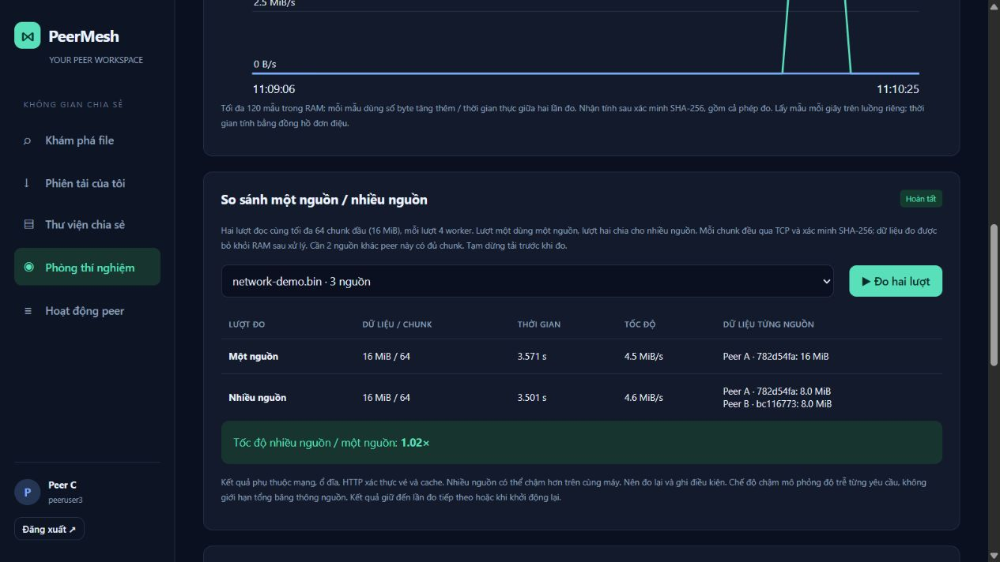

# Xác minh phòng thí nghiệm P2P — 18/10/2026

Java 17, Spring Boot 3.5.16, Windows; tracker và ba peer Java thật trên localhost, profile test độc lập.

- Maven reactor package: **PASS**; **13/13 JUnit**, không lỗi, không bỏ qua.
- Chế độ CORRUPT tạo payload sai hash thật, receiver từ chối, buffer nguồn nguyên vẹn: PASS.
- DISCONNECT đóng socket; SLOW tạo độ trễ thực; NORMAL phục hồi: PASS.
- Tự hết hạn lỗi sau thời hạn cấu hình: PASS.
- API lab yêu cầu đăng nhập; chặn tải file trong lúc đo: PASS.
- Hai lượt TCP cùng 64 chunk / 16 MiB, cùng 4 worker: PASS.
- Lượt một nhận từ một nguồn, lượt hai nhận 8 MiB từ mỗi nguồn trong hai nguồn: PASS.
- Đo không tạo thư viện / checkpoint / phiên tải; phép đo có chunk sai báo ERROR: PASS.
- Snapshot có cạnh TCP đang yêu cầu và mẫu tốc độ dương, tối đa 120 mẫu: PASS.
- Download phát hiện lỗi hash được mô phỏng, chuyển nguồn và hoàn tất đúng SHA-256: PASS.
- Hồi quy: WebSocket xác thực, tạm dừng / restart / loại chunk hỏng, resume, tắt nguồn thật, lịch sử chunk lưu bền, reseeding và restart tracker: PASS.

Kết quả máy đọc được: [lab-e2e-result.json](./lab-e2e-result.json). Lần E2E ghi nhận một nguồn 3,576 giây, nhiều nguồn 3,512 giây cho cùng 16 MiB. Đây là kết quả localhost; không kết luận mức tăng tốc trên LAN.

Đã kiểm tra trực tiếp giao diện: đăng nhập, mở Phòng thí nghiệm, bấm Đo hai lượt và thấy bảng hoàn tất (16 MiB mỗi lượt), tốc độ, tỷ số, dữ liệu từng nguồn. Sơ đồ hiện nguồn A/B, tracker điều phối, các nguồn vừa nhận và số chunk thực; đồ thị hiện lưu lượng đo. Ảnh sau phép đo nên số kết nối đang mở bằng 0.




Chạy lại sau build:

```powershell
python source/client/src/test/resources/e2e.py
```

Thêm `--hold 90` để giữ các tiến trình test cho kiểm tra giao diện; khi hết thời gian, script đóng các tiến trình đã tạo. Phần mạng LAN thật còn cần chạy trên nhiều máy trước buổi trình bày.
